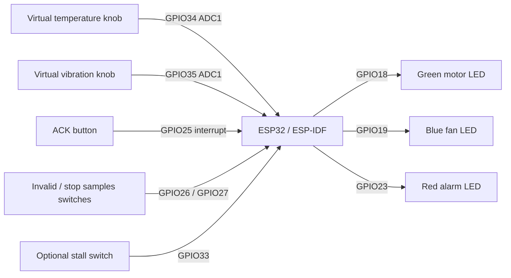
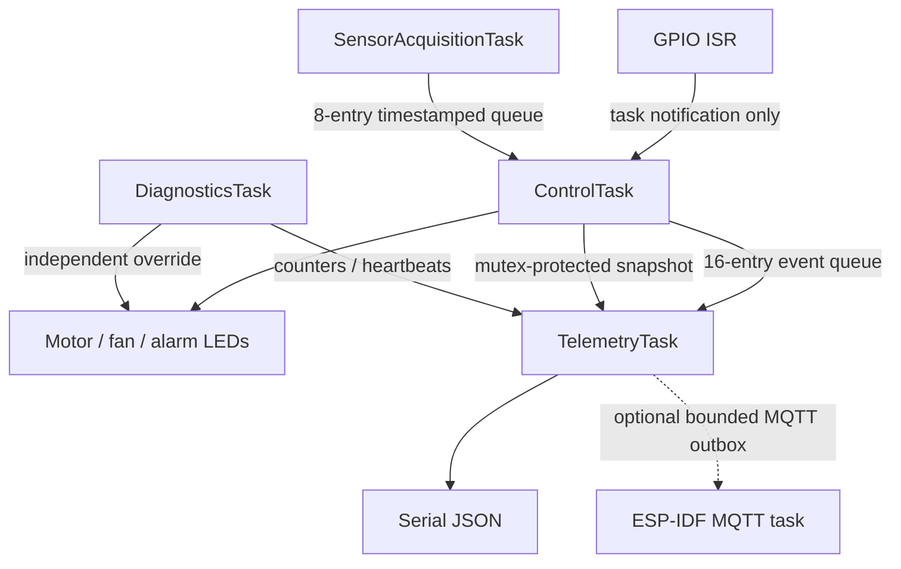
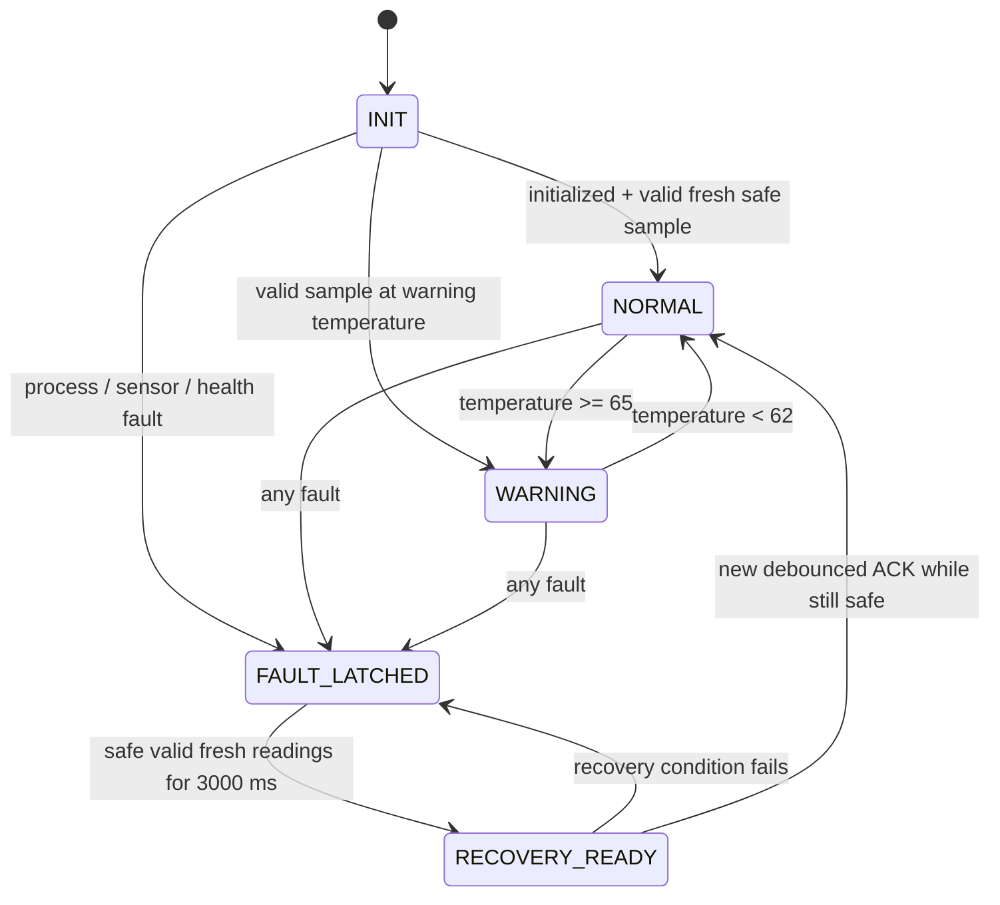

# IndustrialRTOS

**A simulated industrial equipment controller built with C++, ESP-IDF and
FreeRTOS.**

A semiconductor-equipment-inspired machine monitors temperature and vibration,
commands virtual motor/cooling LEDs, detects process and software faults, and
requires safe conditions plus operator acknowledgment before restarting. The
interesting engineering is in fault recovery, bounded concurrency, and testing.
This is a learning project with fictional limits, not a certified safety system.

## Verification status

- ESP32 firmware compilation: verified with **ESP-IDF v5.4.2**.
- Native contracts: **35 passing C++ tests**, plus a Python check of the actual
  walkthrough's JSON and recovery sequence. See [evidence](docs/results.md).
- Wokwi wiring and flash configuration: supplied and checked against documented
  part pins and ESP-IDF ADC mappings.
- **Wokwi runtime, actual GPIO/ISR behavior and MQTT broker connectivity have not
  been verified in this environment.** No simulator token/CLI was configured.
- No measured hardware response times or certified safety claims.

## Quick laptop demo (works without ESP-IDF or Wokwi)

Requirements: CMake >=3.16, a C++17 compiler, and Python 3. No Python packages.

```sh
./scripts/test.sh
./build-host/host_demo
./build-host/host_demo --interactive
```

The native demo executes the **same controller and JSON formatter** as the ESP32
firmware with synthetic readings and virtual time. It does not emulate the MCU,
GPIO ISR, ADC, network stack or FreeRTOS scheduling.

Interactive example (press Enter after each line):

```text
temp 85
advance 200
ack
temp 40
advance 3500
ack
samples off
advance 500
samples on
advance 3500
ack
vibration 8
advance 200
```

Commands: `temp N`, `vibration N`, `invalid on/off`, `samples on/off`,
`heartbeat on/off`, `network on/off`, `ack`, `advance MS`, `quit`.
`advance` accepts 0..60000 ms and advances in 50 ms steps. `network` changes
only reported connection status; it never establishes a real connection.
[Recorded native output](docs/host-demo.jsonl) is clearly labeled virtual-time
logic evidence. Its timing/stack fields are zero because those are not measured.

## Firmware setup and Wokwi

Use the official [ESP-IDF installation workflow](https://docs.espressif.com/projects/esp-idf/en/v5.4.2/esp32/get-started/index.html).
The validated toolchain is v5.4.2; do not assume compatibility with every newer
major version. In particular, this release includes the official `mqtt` component.

```sh
# In your ESP-IDF checkout (one-time installation):
./install.sh esp32
. ./export.sh
# Then, in the IndustrialRTOS directory:
idf.py set-target esp32
idf.py build
```

Open **this project directory** in VS Code with the Wokwi extension. Run
**Wokwi: Start Simulator** from the command palette. An extension license may be
required; see [Wokwi setup](https://docs.wokwi.com/vscode/getting-started).
There is no physical flashing step.

`wokwi.toml` points at `build/flasher_args.json`, loading the bootloader, partition
table and application together, and `build/IndustrialRTOS.elf` for symbols. Keep
the generated flash-layout file alongside its referenced binaries. Do not load
just the application binary and expect an empty virtual flash to boot.

The temporary toolchain used for this delivery is at
`/private/tmp/industrialrtos-esp-idf-v5.4.2`; its tools are at
`/private/tmp/industrialrtos-idf-tools`. These paths are temporary and may be
removed by macOS. If still present, activate it using:

```sh
export IDF_TOOLS_PATH=/private/tmp/industrialrtos-idf-tools
export PATH=/Library/Frameworks/Python.framework/Versions/3.12/bin:$PATH
. /private/tmp/industrialrtos-esp-idf-v5.4.2/export.sh
```

For sandboxed/offline builds with no managed components, you can use
`IDF_COMPONENT_MANAGER=0 idf.py build`. All dependencies in this project are
bundled with the selected ESP-IDF release.

## Virtual equipment and pinout

| Input/output | GPIO | Meaning |
| --- | --- | --- |
| Temperature knob | 34 / ADC1 CH6 | 20–100 °C, direct analog surrogate |
| Vibration knob | 35 / ADC1 CH7 | 0–10 arbitrary demo units |
| Green LED | 18 | Motor enable command |
| Blue LED | 19 | Cooling command |
| Red LED | 23 | Latched alarm |
| Blue ACK button | 25 | Active low; interrupt notification, task debounce |
| INVALID switch | 26 | Ground to inject invalid samples |
| STOP SAMPLES switch | 27 | Ground to stop publishing samples |
| CONTROL STALL switch | 33 | Ground to inject a stall when demo option is enabled |



Start fault switches disconnected from ground. Each LED has a virtual 220 Ω
resistor. LEDs represent logical outputs, **not actual motor drivers**. Knobs are
sensor surrogates; vibration is not a physical accelerometer RMS measurement.
Use the serial measurement values to find thresholds. Full wiring and source
references: [pinout](docs/pinout.md), [diagram.json](diagram.json).

## FreeRTOS architecture

All four application tasks are pinned to ESP32 core 1. ESP-IDF Wi-Fi/system tasks
may run separately. Larger priority numbers mean higher priority.

| Task | Priority | Stack bytes | Period | Responsibility |
| --- | ---: | ---: | ---: | --- |
| DiagnosticsTask | 7 | 3072 | 100 ms | Heartbeats, deadline supervision, independent motor inhibition |
| SensorAcquisitionTask | 6 | 3072 | 100 ms | ADC inputs, validity checks, timestamped bounded-queue writes |
| ControlTask | 5 | 4096 | 50 ms | State machine, ACK debounce, output interlocks |
| TelemetryTask | 2 | 6144 | 1000 ms | JSON serial output, transition events, optional network service |



Periodic tasks use `vTaskDelayUntil`. Task creation allocates once at boot; the
queues and snapshot mutex use static storage. Recurring acquisition/control paths
use fixed storage and no explicit heap allocation. Snapshot locks cover only
bounded data operations and use priority inheritance. No serial/network logging
runs in the controller or ISR. Transition/ACK events are queued for telemetry;
if the event queue fills, events are dropped and counted rather than blocking.

Every queued sample is evaluated, so a short critical reading cannot be hidden
by a newer safe reading. Sensor queue overflow trips a conservative task-health
interlock because lost measurements could hide an unsafe transient. GPIO writes
and diagnostics overrides share a cross-core critical section. A pending trip
survives until the controller observes it and latches the state-machine fault.

## State machine and exact thresholds



| Condition | Threshold / behavior |
| --- | --- |
| Warning temperature | >=65 °C; clears strictly below 62 °C |
| Critical temperature | >=80 °C |
| Critical vibration | >=7 demo units |
| Safe recovery | temperature <60 °C AND vibration <4, valid/fresh, healthy tasks |
| Recovery dwell | 3000 ms; any unsafe/invalid/stale step resets it |
| Cooling hysteresis | on >=55 °C; off <50 °C outside warning/latched states |
| Sample freshness | valid through age 350 ms; fault at >350 ms |
| ACK debounce | stable press/release for 50 ms; boot-held button must release |
| Control completion deadline | >75 ms since last control completion trips supervision |
| Critical-task heartbeat limits | sensor 300 ms, control 150 ms, diagnostics 300 ms |
| Telemetry heartbeat limit | 3000 ms; advisory only, does not stop motor |

Sensor initialization failure leaves motor disabled and lights fan/alarm; reset
is required to retry initialization. Missing startup samples have a 350 ms grace.
Faults disable the motor, enable fan/alarm, and latch. A warm but noncritical
reading can keep the controller latched because recovery limits are stricter
than fault limits. Acknowledgment before readiness, while unsafe, or on the very
step that enters readiness is rejected and is not remembered. A later **new
press** is required. Holding ACK cannot repeatedly restart the equipment.

All simultaneous fault bits are preserved and accumulate until acknowledged.
Primary reporting priority: **TASK_HEALTH > CONTROL_DEADLINE > SENSOR_TIMEOUT >
INVALID_SAMPLE > TEMPERATURE > VIBRATION**. Motor inhibition takes precedence
over all normal/warning commands. Invalid/nonfinite/out-of-range values and
future timestamps fail closed. Cooling during faults is a fictional policy;
actual equipment may need a different safe-output design.


## Tests and repository structure

```text
main/                    FreeRTOS orchestration, GPIO ISR, configuration
components/control/      Pure C++ state machine and button debouncer
components/sensors/      ESP-IDF ADC acquisition and fault switches
components/diagnostics/  Pure heartbeat/deadline/counter logic
components/telemetry/    Bounded JSON, retry policy, optional ESP-IDF network
tests/                   Native contracts, interactive demo, JSON acceptance
 docs/                   Wiring, validation, recorded native evidence
.github/workflows/       Host sanitizers + offline/MQTT ESP32 build jobs
```

```sh
./scripts/test.sh -DENABLE_SANITIZERS=ON
```

The 35 C++ tests cover the 14 requested categories plus boundary values,
nonfinite input, button bounce, transient preservation and 2000 deterministic
mixed-input invariant checks. The disconnect test verifies the production
logic/serialization boundary; it does not claim a live broker was disconnected.
The overflow test verifies the actual production counter and conservative
interlock contracts; native tests do not execute FreeRTOS queue internals.
GitHub Actions is supplied, but its remote execution has not been observed.
